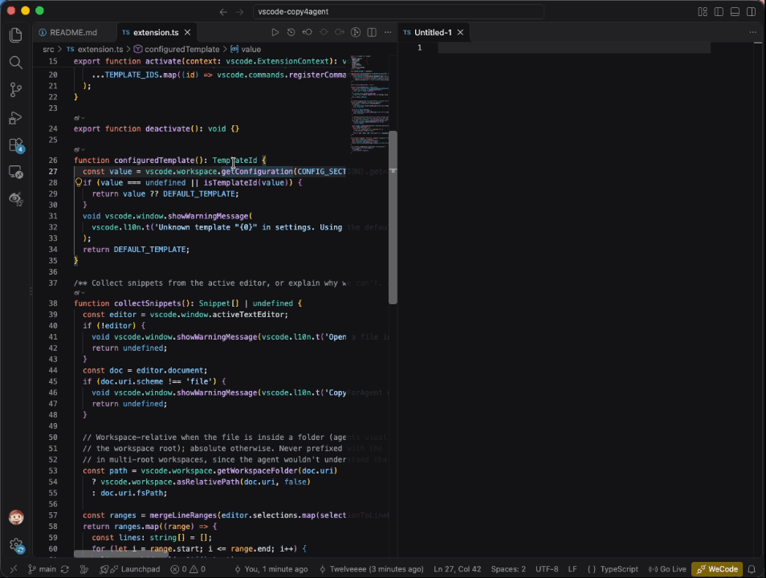

<p align="center">
  
</p>

# CopyForAgent

Copy the code you selected as a file reference, ready to paste into an AI agent conversation: Claude Code, Codex, DSH, Cursor and others.

```
@src/app.py:10-30
```



[中文说明](#中文说明)

## Usage

Right-click in the editor:

| Command | What it does |
| --- | --- |
| **Copy for Agent** | Copies using the template chosen in settings. This is the everyday path. |
| **Copy for Agent with Template** ▸ | A submenu listing every template. Pick one to use it for this copy only. Your setting stays the same. |

The commands are only in the editor context menu, not in the Command Palette. You can hide the submenu with `copy4agent.contextMenu.showCopyWithTemplate`.

No keyboard shortcuts are bound by default. In Settings, the **Set keyboard shortcuts** link under **Template** opens Keyboard Shortcuts filtered to this extension. Bind `copy4agent.copy` for the default template, or `copy4agent.copyAs.<template>` (for example `copy4agent.copyAs.atPathWithCode`) for a specific one.

### What gets copied

- If text is selected, the selected lines are copied. Otherwise the current line is copied.
- Line numbers are the ones shown in the editor gutter. When you drag-select whole lines, VS Code puts the selection end at column 0 of the next line. That line is not included.
- If only part of a line is selected, the whole line is still referenced, and copied when the template includes code, so the code matches the line numbers.
- With multiple cursors, each selection becomes its own reference. Overlapping or adjacent selections are merged.
- Paths are relative to the workspace folder that contains the file. Files outside any workspace folder get an absolute path.
- Only files on disk (`file://`) are supported. Untitled, remote virtual and other non-file documents are not.

## Templates

Choose one under **Settings → Extensions → CopyForAgent → Template** (`copy4agent.template`). The set is fixed, so you can't write your own template strings.

| Setting value | Output | Use it for |
| --- | --- | --- |
| `atPath` (default) | `@src/app.py:10-30` | Claude Code, Codex, Cursor and most agents that resolve `@` file mentions. The agent reads the lines itself. |
| `atPathWithCode` | `@src/app.py:10-30`<br>`<selected code>` | Terminal agents, when you want the exact snippet in the conversation. |
| `atPathWithFencedCode` | `@src/app.py:10-30`<br>` ```python `<br>`<selected code>`<br>` ``` ` | Chat UIs that render Markdown. |
| `atPathHashL` | `@src/app.py#L10-30` | The format Claude Code's own IDE integration inserts. |
| `plainPath` | `src/app.py:10-30` | Inputs where `@` opens a picker or isn't understood. Cmd/Ctrl-click also works on it in the VS Code terminal. |

A single line is written without a range, for example `@src/app.py:12`.

## Languages

English, 简体中文 and 繁體中文. The extension follows VS Code's display language (**Configure Display Language**). It uses VS Code's built-in localization: `package.nls.*.json` for the manifest and `l10n/bundle.l10n.*.json` with `vscode.l10n` for runtime text.

## Development

```sh
npm install
npm test          # compile + unit tests
npm run package   # build a .vsix
npm run icon      # re-export resources/icon.png from resources/icon.svg (needs rsvg-convert)
```

Press F5 in VS Code to launch an Extension Development Host. The second launch configuration starts it in Chinese.

The icon is designed as SVG in [`resources/icon.svg`](resources/icon.svg). vsce rejects SVG both as the manifest `icon` and as images in the README, so both use the exported `resources/icon.png` (256×256).

### Releasing

Every push to `main` and every pull request runs the tests and packages the extension (`.github/workflows/ci.yml`).

Publishing a GitHub release publishes to the Marketplace (`.github/workflows/release.yml`):

1. Bump `version` in `package.json` and add a `CHANGELOG.md` entry. Commit and push.
2. Create a release whose tag is `v` plus that version, for example `gh release create v0.2.0 --generate-notes`.
3. The workflow tests, checks that the tag matches `package.json`, publishes with vsce, and attaches the `.vsix` to the release.

GitHub pre-releases are skipped.

One-time setup: the workflow signs in with [Trusted Publishing](https://code.visualstudio.com/api/working-with-extensions/publishing-extension) (GitHub OIDC), so no token or secret is needed. At <https://marketplace.visualstudio.com/manage>, open the `Twelveeee` publisher, go to **Trusted Publishing → Create**, and enter:

| Field | Value |
| --- | --- |
| Repository owner | `Twelveeee` |
| Repository | `vscode-copy4agent` |
| Workflow | `release.yml` |
| Environment | *(leave empty)* |

## License

[MIT](LICENSE)

---

## 中文说明

把选中的代码复制成文件引用，直接粘贴给 AI Agent（Claude Code、Codex、DSH、Cursor 等）。开发与发布说明见上方 [Development](#development) 部分（英文）。

### 使用

在编辑器中右键：

| 命令 | 作用 |
| --- | --- |
| **复制给 Agent** | 使用设置中选定的模板复制，日常使用这个。 |
| **复制给 Agent（选择模板）** ▸ | 子菜单列出所有模板，选中后仅本次使用该模板，不会修改设置。 |

命令只出现在编辑器右键菜单中，不在命令面板里。可通过 `copy4agent.contextMenu.showCopyWithTemplate` 隐藏子菜单。

默认不绑定快捷键。在设置中 **Template** 下点击 **设置快捷键** 链接，会打开已筛选出本扩展命令的键盘快捷方式页面。为 `copy4agent.copy` 绑定快捷键即使用默认模板；为 `copy4agent.copyAs.<模板>`（例如 `copy4agent.copyAs.atPathWithCode`）绑定则使用指定模板。

#### 复制规则

- 有选区就用选区，否则用光标所在行。
- 行号与编辑器左侧行号一致。拖选整行时，VS Code 会把选区终点放在下一行第 0 列，这一行不会被算进去。
- 只选中了一行中的一部分时，仍按整行引用；带代码的模板也会复制整行，保证代码与行号对应。
- 多光标时每个选区各生成一条引用，重叠或相邻的选区会合并。
- 路径相对于文件所在的工作区文件夹；不在任何工作区文件夹内的文件使用绝对路径。
- 仅支持磁盘上的本地文件（`file://`），不支持未保存的新文件、远程虚拟文件等。

### 模板

在 **设置 → 扩展 → CopyForAgent → Template**（`copy4agent.template`）中选择。模板集合是固定的，不支持自定义模板字符串。

| 设置值 | 输出 | 适用场景 |
| --- | --- | --- |
| `atPath`（默认） | `@src/app.py:10-30` | Claude Code、Codex、Cursor 以及大多数支持 `@` 文件引用的 Agent，由 Agent 自行读取代码。 |
| `atPathWithCode` | `@src/app.py:10-30`<br>`<选中的代码>` | 终端 Agent，需要把代码片段原文带进对话时。 |
| `atPathWithFencedCode` | `@src/app.py:10-30`<br>` ```python `<br>`<选中的代码>`<br>` ``` ` | 会渲染 Markdown 的聊天界面。 |
| `atPathHashL` | `@src/app.py#L10-30` | 与 Claude Code 自带 IDE 集成插入的格式一致。 |
| `plainPath` | `src/app.py:10-30` | 输入 `@` 会弹出文件选择器或不识别 `@` 的场景。在 VS Code 终端中也可 Cmd/Ctrl+点击跳转。 |

单行时不写范围，例如 `@src/app.py:12`。

### 语言

支持 English、简体中文、繁體中文，跟随 VS Code 的显示语言（**Configure Display Language**）。使用 VS Code 官方本地化机制：清单文本在 `package.nls.*.json`，运行时文本通过 `vscode.l10n` 读取 `l10n/bundle.l10n.*.json`。
